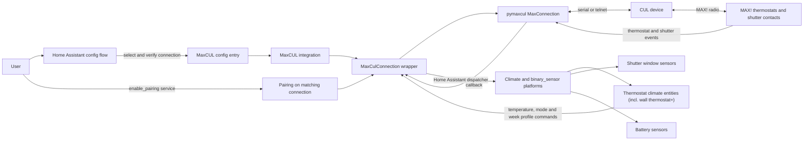
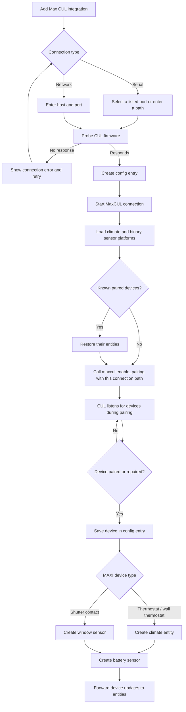

# MaxCUL Component for Home Assistant

Control MAX! eQ-3 radiator thermostats, wall thermostats, and shutter contacts
using a CUL device connected to Home Assistant over USB/serial or a network
telnet connection.

> **Note:** This integration was originally written for personal use and is not
> actively maintained. Hardware, firmware, and Home Assistant versions may
> affect compatibility. It is intentionally not distributed through HACS.
> Contributions and bug reports are welcome.

## Install

Copy `custom_components/maxcul` into the `custom_components` directory of your
Home Assistant configuration, then restart Home Assistant.
On Home Assistant 2026.3 and newer, the integration icon is loaded from the
included brand assets and appears in the integration list after restart.

## Set up

1. In Home Assistant, open **Settings → Devices & services → Add integration**.
2. Search for **Max CUL**.
3. Choose **Serial port** for a directly connected CUL, or **Network** for a
   CUL telnet server.
4. If your serial device is not listed, choose **Enter manually** and provide
   its stable path (prefer `/dev/serial/by-id/...` on Linux).
5. The integration checks that the device responds to a CUL firmware query.

After setup, pair MAX! devices with the CUL. The integration creates climate
entities for thermostat models, including wall thermostat variants, and window
sensors for shutter contacts; battery sensors are also created for paired
devices.

### What the integration provides

| Device or feature | Home Assistant item |
| --- | --- |
| MAX! heating thermostat | Climate entity with target temperature, mode, preset, and reported valve position |
| MAX! wall thermostat | Climate entity |
| MAX! shutter contact | Window binary sensor |
| Paired MAX! device | Diagnostic battery binary sensor |
| Week schedule | `maxcul.set_week_profile` service and MAX! week-profile dashboard card |
| Window-to-thermostat link | `maxcul.associate` and `maxcul.deassociate` services |

The integration is local-push: entity updates arrive when the CUL receives a
MAX! radio message. It does not poll devices on a fixed interval, and values
such as current temperature or valve position may be unknown until the next
device update.

## Architecture

The integration uses a local-push connection: `pymaxcul` communicates with the
CUL, and its events are forwarded through Home Assistant's dispatcher to the
platform entities. Pairing is started through the `maxcul.enable_pairing`
service.



## Setup and pairing flow



## Pairing devices

Call the `maxcul.enable_pairing` service. When only one CUL connection is loaded,
the service uses it automatically. If multiple CUL connections are loaded, enter
the configured connection path to select the right one. For a network CUL, use
the same address entered during setup, for example
`telnet://192.168.1.10:2323`. Pairing lasts 30 seconds by default; set a duration
from 1 to 300 seconds.

Devices reported by a MAX! pairing or repair announcement are saved in the
integration entry and restored after restart. The CUL/pymaxcul interface does
not provide an inventory of every device previously paired to the CUL, so a
device missing from Home Assistant cannot be rediscovered just by restarting.
It must announce itself again through pairing or repair.

Example service call for one configured CUL:

```yaml
action: maxcul.enable_pairing
data:
  duration: 60
```

If multiple CUL connections are loaded, select one explicitly:

```yaml
action: maxcul.enable_pairing
data:
  device_path: "telnet://192.168.1.10:2323"
  duration: 60
```

Use the same serial path or telnet address that you entered during setup.
Pairing is enabled for 30 seconds by default; the duration can be set from 1
to 300 seconds.

## Controlling a thermostat

MAX! thermostats appear as Home Assistant `climate` entities. You can adjust
the temperature from the thermostat entity card or call Home Assistant's
standard climate actions:

```yaml
action: climate.set_temperature
target:
  entity_id: climate.living_room
data:
  temperature: 20.5
```

The supported HVAC modes are `off`, `auto`, and `heat`:

```yaml
action: climate.set_hvac_mode
target:
  entity_id: climate.living_room
data:
  hvac_mode: auto
```

The preset modes are `none`, `away`, and `boost`. For example, select boost
with:

```yaml
action: climate.set_preset_mode
target:
  entity_id: climate.living_room
data:
  preset_mode: boost
```

The thermostat reports its valve position as the `valve_position` state
attribute. This is not a direct measurement of radiator water flow. The
integration does not provide a command to set valve position or to change the
thermostat's LOC keypad lock.

## Setting a thermostat week profile

Call `maxcul.set_week_profile` with a thermostat selected from the service
dialog's entity dropdown, or provide its hexadecimal address or saved friendly
name, along with a complete seven-day schedule. Each line uses a weekday
followed by alternating temperatures and switch times; the last temperature
applies until midnight. If the same address is paired through multiple CUL
connections, also provide `device_path`. For example:

```yaml
action: maxcul.set_week_profile
data:
  device_id: "67e2e"
  week_profile: |-
    Mon 21,06:00,17,22:00,16
    Tue 21,06:00,17,22:00,16
    Wed 21,06:00,17,22:00,16
    Thu 21,06:00,17,22:00,16
    Fri 21,06:00,17,22:00,16
    Sat 21,08:00,17,23:00,16
    Sun 21,08:00,17,23:00,16
```

The days can each have their own schedule and can include more than two
temperature changes. This example starts weekdays earlier than the weekend and
uses a midday setback:

```yaml
action: maxcul.set_week_profile
data:
  device_id: "67e2e"
  week_profile: |-
    Mon 20,05:30,16,08:00,19,12:00,17,17:30,21,22:00,16
    Tue 20,05:30,16,08:00,19,12:00,17,17:30,21,22:00,16
    Wed 20,05:30,16,08:00,19,12:00,17,17:30,21,22:00,16
    Thu 20,05:30,16,08:00,19,12:00,17,17:30,21,22:00,16
    Fri 20,05:30,16,08:00,19,12:00,17,17:30,21,23:00,16
    Sat 20,08:00,17,10:00,21,23:30,16
    Sun 20,08:30,17,10:00,21,22:00,16
```

You can also use a simpler schedule with different wake-up and bedtime times
for each day:

```yaml
action: maxcul.set_week_profile
data:
  device_id: "67e2e"
  week_profile: |-
    Mon 19,06:15,21,08:00,16,18:00,21,22:15,17
    Tue 19,06:15,21,08:00,16,18:00,21,22:15,17
    Wed 19,06:45,21,08:30,16,18:00,21,22:15,17
    Thu 19,06:15,21,08:00,16,18:30,21,22:30,17
    Fri 19,06:15,21,08:00,16,16:30,21,23:30,17
    Sat 19,08:30,21,10:00,17,17:00,21,23:45,17
    Sun 19,09:00,21,10:30,17,17:00,21,22:30,17
```

Temperatures must be between 4.5 °C and 30.5 °C in 0.5-degree steps, and
switch times must use 5-minute increments. Up to 13 temperatures (12 switch
times) can be defined per day. Times must be strictly increasing and before
midnight, and all seven days are required. A constant schedule can be written
as a single temperature, for example `Tue 20`.

The latest schedule sent from Home Assistant is stored locally in the
integration entry and exposed on the thermostat entity as
`maxcul_week_profile`. Its status is available as
`maxcul_week_profile_status` (`pending`, `acknowledged`, or `failed`). An
acknowledgement means the thermostat responded to the profile messages. It
does not let Home Assistant read back or compare the thermostat's saved
schedule. A schedule programmed outside Home Assistant cannot be retrieved by
this integration.

To send a schedule from an automation or script, use the same action and
provide all seven days. This example uses a thermostat entity ID:

```yaml
action: maxcul.set_week_profile
data:
  device_id: climate.living_room
  week_profile: |-
    Mon 20,06:00,17,22:00,16
    Tue 20,06:00,17,22:00,16
    Wed 20,06:00,17,22:00,16
    Thu 20,06:00,17,22:00,16
    Fri 20,06:00,17,22:00,16
    Sat 20,08:00,17,23:00,16
    Sun 20,08:00,17,23:00,16
```

Use the thermostat selector in the service dialog when possible. Automations
may also use a saved friendly name or the hexadecimal MAX! address printed in
the `maxcul._communication` debug log. The `maxcul_device_id` entity attribute
is decimal; for example, hex address `67e2e` is decimal `425518`. If the same
device address is paired through multiple CUL connections, specify
`device_path`.

### MAX! week-profile dashboard card

The integration provides a visual card for editing and sending a weekly
schedule. After restarting Home Assistant, add the card as a dashboard
resource:

1. Open **Settings → Dashboards → Resources**.
2. Add `/maxcul/week-profile-card.js` as a **JavaScript module** resource.
3. Add a **Manual** card and choose **MAX! Wochenprofil**, or configure it in
   YAML. Select the thermostat entity in the card editor.

Example card YAML:

```yaml
type: custom:maxcul-week-profile
device_id: climate.living_room
```

You can also use the hexadecimal device address:

```yaml
type: custom:maxcul-week-profile
device_id: "67e2e"
# Optional when the same device is paired through more than one CUL:
# device_path: "/dev/ttyUSB0"
```

Click a day's timeline to add a temperature change, then edit the times and
temperatures in the fields. **Wochenprofil ans Thermostat senden** transmits
the complete week. The card displays the last profile sent from Home
Assistant—it cannot read the schedule back from the thermostat. A green check
means the thermostat responded to the profile messages; a clock means the
card is waiting for a response; a warning means no response arrived.

If the card shows 20 °C on every day, it has not loaded a saved profile for the
selected thermostat. Check the selected entity and its `maxcul_week_profile`
attribute. Do not send the default schedule unless that is what you intend to
program.

If Home Assistant or the browser keeps a previous JavaScript copy after an
update, change the resource URL to `/maxcul/week-profile-card.js?v=2` and
reload the dashboard. Increase the version number on future updates.

## Associate a window contact with a thermostat

Call `maxcul.associate` to create the MAX! link in both directions. Both devices
must be paired to the same loaded CUL connection. In the service dialog, select
the thermostat and window contact from the entity dropdowns. YAML calls may
also use their entity IDs, saved friendly names, or hexadecimal addresses shown
in the `maxcul._communication` debug log (for example, `67e2e`). Names must
identify each device uniquely; use hexadecimal addresses and `device_path` if
there are duplicates.

```yaml
action: maxcul.associate
data:
  thermostat_id: climate.living_room
  window_contact_id: binary_sensor.kitchen_window
  device_path: "/dev/ttyUSB0"
```

The thermostat does not need to be put into pairing mode: the service sends
the link commands to both devices. After calling it, open or close the window
to trigger the contact's reed relay and wake it so it can receive its link
command. Do **not** press the pairing button on the back of the contact. The
connection retries the command while waiting for an acknowledgement.

To remove both links, call `maxcul.deassociate` with the same device fields.
The contact may need a window state change to wake and receive the command:

```yaml
action: maxcul.deassociate
data:
  thermostat_id: climate.living_room
  window_contact_id: binary_sensor.kitchen_window
```

## Options

The **CUL radio address** option defaults to `0x123456` (`1193046`, entered as
decimal in the options form). Change it only when you need to assign a
different 24-bit radio address to the CUL.

## Inspecting entities

Open **Developer Tools → States** and select a MaxCUL entity to inspect its
latest values. Thermostat entities include these integration-specific
attributes:

| Attribute | Meaning |
| --- | --- |
| `maxcul_device_id` | MAX! device address in decimal |
| `maxcul_device_name` | Saved MAX! friendly name |
| `valve_position` | Valve position most recently reported by the thermostat |
| `maxcul_week_profile` | Last complete schedule sent from Home Assistant, when available |
| `maxcul_week_profile_status` | Latest send status: `pending`, `acknowledged`, or `failed` |

The current temperature and valve position can be `null` until a thermostat
message containing those values is received. Valve position is not a
measurement of actual radiator water flow.

## Troubleshooting

- **Device not listed:** connect it before opening the flow, or enter its serial
  path manually.
- **Could not communicate with a CUL:** check that the CUL is powered on, that
  the serial path is correct, that Home Assistant can access the serial device,
  or that the telnet host and port are reachable. On Linux, the Home Assistant
  process may need permission to access the serial device.
- **Pairing service cannot find the connection:** enter the same serial path or
  telnet address used to set up that config entry.
- **A paired device is missing after restart:** the integration restores devices
  saved in its config entry. pymaxcul cannot query a complete device inventory
  from the CUL, so the missing device must announce itself through pairing or
  repair again.
- **Association does not complete:** check that both devices are paired to the
  same loaded CUL, call the service, then open or close the window to wake the
  contact. A low CUL send budget can delay transmissions or replies.
- **The week-profile card shows 20 °C on every day:** this is the editor's
  default when no saved profile was loaded. Check the selected thermostat and
  whether its state has a `maxcul_week_profile` attribute. Do not send the
  default schedule unless intended.
- **A week profile is not confirmed:** confirmation depends on replies to the
  sent messages. Check that the CUL has enough send budget and the thermostat
  is reachable. The stored thermostat schedule cannot be read back for
  comparison.
